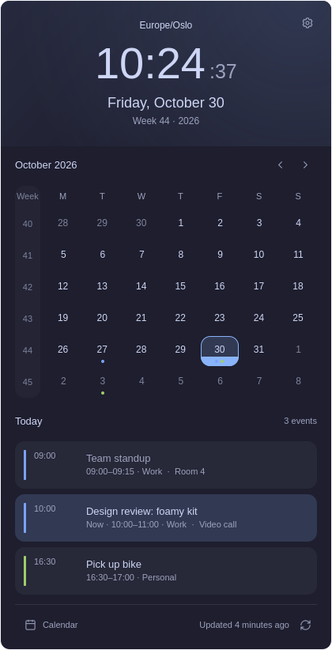

# Foamy Clock

A clock, month calendar, and calendar agenda.



## Install

Built for Omarchy 4.5; also loads on Omarchy 4.0.6. Requires Python 3. Agenda access also uses
`python-gobject` and Evolution Data Server (`evolution-data-server`).

For events, install GNOME Calendar (`gnome-calendar`) and select your calendars.

```sh
omarchy plugin add https://github.com/foamrider/foamy-clock.git --enable
```

## Use

- Left-click the clock to open the calendar. Select a day to see its events.
- Use the chevrons (or the scroll wheel) to change month; click the header to return to today.
- Open the cog to change the date locale, time format, bar formats and agenda settings.
- Right-click the bar clock to cycle formats. Middle-click opens the timezone picker.

Keyboard: arrows or `hjkl` move the day cursor (a day, or a week up/down),
Enter or Space selects that day (or returns to today when there is no cursor),
`[` `]` and `{` `}` step months and years, `t` is today, `w` flips the week
start, `s` opens Settings, `r` refreshes the agenda, Page Up/Down scroll the
agenda, Tab/Shift-Tab switch to the neighbouring bar panel and Esc closes.

"Show seconds in the popup" affects the popup clock only. The bar shows
seconds when its format contains them (for example `HH:mm:ss`); the bar label
then ticks every second, otherwise every minute.

The date locale setting "Omarchy language" (4.5; "System" on 4.0) uses the
date conventions of the language picked in Omarchy Setup (on 4.0, the system
locale). Pick a locale to override it.

IPC (`omarchy-shell foamy.clock <fn>` on 4.5, `qs ipc call foamy.clock <fn>`):
`open`, `close`, `toggle`, `settings`, `refresh`, `cycleFormat`, `toggleWeekStart`.

The calendar shortcut opens GNOME Calendar by default; change it in settings.

## Agenda behavior

The agenda preloads event summaries for all 42 dates in the visible month grid
with one range query per selected calendar. Event dots and daily agendas use the
same data. Selecting a loaded day, including an empty day, is immediate and does
not query Evolution or interrupt a background refresh.

Nothing touches Evolution until you first open the popup: the bar only shows
the time. On 4.5, with a bar on every monitor, one shared engine serves all of
them. While a popup is open, the current month and the next three calendar
months are refreshed automatically; when it is closed, nothing polls. Opening
the popup shows cached data at once and refreshes stale months behind it. The visible
month loads first; background months load one at a time and yield when you need
another month or press Refresh. Fresh cached months are reused. Background work
uses the configured agenda refresh interval, with due times checked each minute;
failed attempts wait for that interval before retrying.

Month views are cached across shell restarts; there is no month-cache setting.
Cached events remain visible while stale data refreshes in the background. The
refresh button always requests fresh data for the visible month. The three-month
horizon rolls forward with the current date and uses your configured week start.

The footer shows **Partial update · open calendar** when the selected day's
refresh is incomplete. Click it, or the Calendar button, to open the full calendar
app. Complete cached dates remain available when their refresh fails, while
successful dates update normally. Empty partial results do not mean that the day
has no events. Incomplete dates also have a warning in their calendar tooltip.

To protect the desktop shell, each month holds at most 1,000 event summaries and
2 MiB of encoded data, with at most 100 events per date. An occurrence spanning
several dates is stored once and referenced from each date. Event titles,
locations, and calendar names have fixed length limits. The panel renders up to
five calendar markers per date and only creates visible agenda rows.

Queries allow 32 selected calendars, two active clients, and 2,048 occurrence
callbacks per source. Worker processes retain the 512 MiB virtual-memory limit
and 45-second deadline. The bridge bounds the full month before parsing it, then
sends at most twelve bounded messages (256 KiB each) to the shell. The shell also
checks the assembled month and replaces its previous view only after receiving
the complete transaction. Resource limits or source failures produce an explicit
incomplete state; displayed partial counts say how many events are shown.
Background prefetch uses the same worker and limits, writes to the disk cache,
and sends no event data to the shell. It does not run alongside a foreground
calendar worker or multiply the shell's in-memory month views.

The private disk cache is limited to 8 MiB and eight recently used views; older
views are evicted automatically. Retained months remain available offline. The
first visit to an uncached month needs a refresh, and offline coverage depends
on which views remain in the cache. The three months ahead become available as
background loading completes; source failures and the fixed cache/event limits
can prevent complete coverage.

The cache lives at `$XDG_CACHE_HOME/foamy-clock/agenda-v3.json` (default:
`~/.cache/foamy-clock/agenda-v3.json`). Writes are serialized with a lock file
beside it, and older `agenda-v1.json`/`agenda-v2.json` caches are deleted on the
next write. Event times without a time zone ("floating") are read in your local
zone (`TZ`, or `/etc/localtime`; `TZ=:/etc/localtime` and absolute paths work). Calendar accounts and events remain
managed by Evolution.

## Remove

```sh
omarchy plugin remove foamy.clock
```

When removing an enabled replacement, Omarchy restores `omarchy.clock`.
Calendar accounts, events, GNOME Calendar, and the agenda cache remain on disk.

Omarchy manages the plugin entry in `shell.json`. Packages and data outside
the plugin directory are retained unless you remove them separately.

## License

Licensed under [MIT](LICENSE), with [Omarchy](LICENSE-OMARCHY) and
[Lucide](LICENSE-LUCIDE) notices.

Provided **as is**, without warranty or guaranteed support. Use at your own risk.

Language follows **Omarchy → Setup → Language** on Omarchy 4.5. Plugin language overrides are no longer used. Omarchy 4.0 displays interface text in English while keeping the system date locale and week start. Missing translations fall back to English.

Date patterns (for example "Friday, October 30" / "fredag 30. oktober") come
from the plugin's translation catalogs, so they follow the Omarchy language. A
date locale other than the Omarchy language (and 4.0) uses that locale's own
long date format without the year.

## Development

`kit/` holds shared components copied from [foamy-kit](https://github.com/foamrider/foamy-kit); edit them there, not here.

Shared UI parts come from [foamy-kit](https://github.com/foamrider/foamy-kit),
vendored under `kit/` (never edit those files; sync from foamy-kit).

```sh
for t in tests/*-test.js tests/i18n.test.cjs; do node "$t"; done
python3 -I -m unittest discover -s tests -p 'test_*.py'
bash tests/kit-check.sh
python3 tests/runtime.py --host both     # offscreen, needs ../foamy-kit
python3 tests/i18n-runtime.py
```

`preview/Preview.qml` holds mock states for the foamy-kit preview harness
(`foamy-kit/preview/render.py`).
